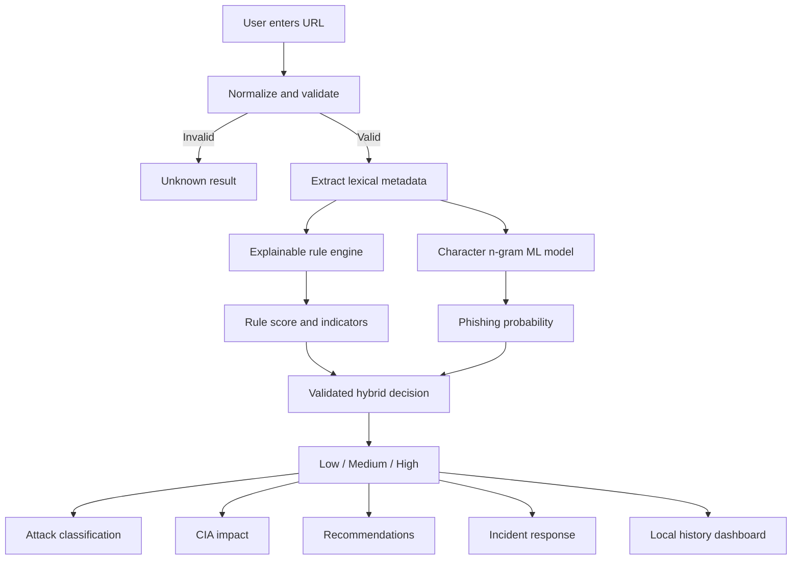
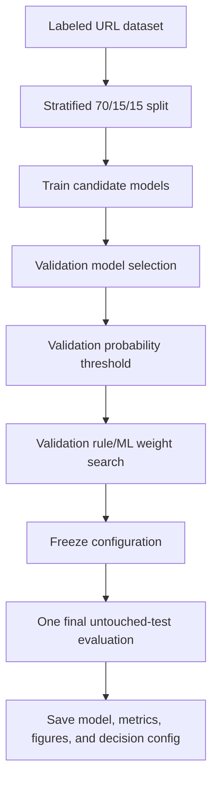

# Architecture

## Runtime flow

## Training flow

## Trust boundaries

The application remains offline during scanning. Submitted URLs are processed locally. It does not contact the destination host, external reputation services, search engines, or WHOIS providers.
